## Original question

> Do older mice spend less time engaged in the decision task than younger mice?

The user asked for this to be tested with the GLM-HMM of Ashwood et al. (2022), fitted with NeMoS.

## Introduction

Ryan, Ye & Churchland (2026) argue that research on cognitive ageing relies mostly on single-metric behavioural
readouts and descriptive neural analyses, and should adopt tools from theoretical neuroscience, including
latent-state modelling, dynamical systems and encoding models. For decision-making, a widely used latent-state
model is the hidden Markov model (HMM). The best-known example is the GLM-HMM of Ashwood et al. (2022). It showed
that mice in the International Brain Laboratory (IBL) task (IBL et al. 2021) switch between an "engaged" strategy,
which relies on the stimulus, and biased strategies. Those biased strategies account for many apparent lapses.
Mohammadi, Ashwood & Pillow (2025) later described IBL biased-block behaviour with four states: two engaged and two
disengaged, each pair split into a left-leaning and a right-leaning state.

Zang et al. (2026) recorded mice of different ages in the IBL task. They reported that older mice performed slightly
worse and had more variable response times. We asked whether a GLM-HMM can tell *how* older mice differ: do they
spend less time engaged, or do they perform worse even when engaged?

**Data.** `ibl_aging_zang2025` v1.0.0 is a local repackaging of the OpenAlyx release tagged
`2025_Q3_Zang_et_al_Aging`. It has 158 mice and 497 sessions of the biased-block visual decision task:

- **BWM cohort:** 139 mice, 92–454 days old (Brain Wide Map sessions, 12 labs);
- **lifespan cohort:** 19 mice, 318–597 days old (18 from one lab).

Lifespan mice contribute 1–3 sessions each and BWM mice 1–13; all sessions were used.

**Design limits.**

- **Age and cohort are confounded.** The cohorts differ in lab, rig and recording year.
- **Every comparison is between mice.** There is no within-mouse ageing.
- **The mouse is the independent unit.**
- **The data are not new to the question.** Zang et al. analysed the same sessions, and an earlier re-analysis
  used the same confirmation mice for reaction-time tests.

## Refinement of the question

### Data split and inputs

Mice were split 30 % / 70 % into exploration (48 mice: 42 BWM, 6 lifespan) and confirmation (110 mice: 97 BWM,
13 lifespan) sets. The split reuses an earlier re-analysis of these data. It was age-stratified, so both sets span
the same ages. Every modelling choice below was made on exploration mice only.

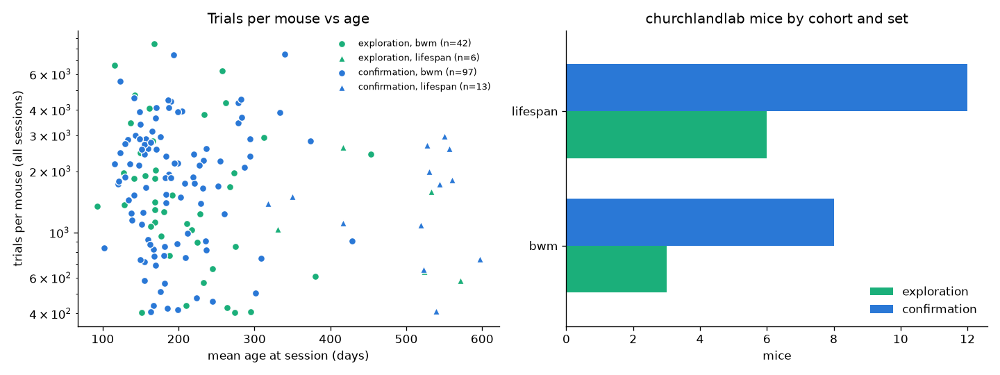{#fig-split}

Each trial's choice was modelled with four inputs plus an intercept:

- signed contrast;
- previous choice;
- previous choice × previous reward (win-stay / lose-switch);
- the block prior: the probability that the stimulus appears on the left in the current block.

The block prior is added because these sessions use 20:80 / 80:20 blocks. Without it, block-driven bias would be
mistaken for "biased" states.

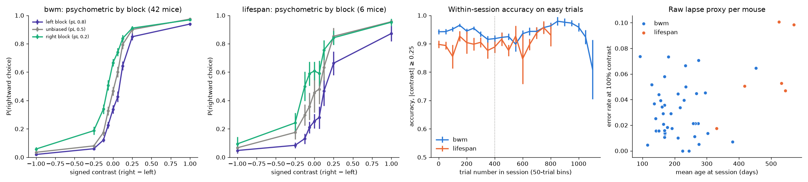{#fig-inputs}

### Model, software and number of states

We used the `GLMHMM` class of NeMoS 0.2.9 (Flatiron Institute). Choices were simulated from a known 3-state model
using the mice's real stimulus sequences. The model recovered each mouse's engaged-state occupancy well, but it
merged the two biased states into one.

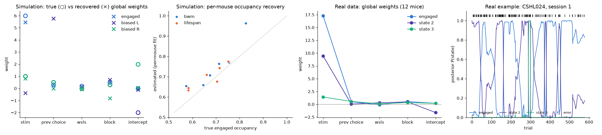{#fig-smoke}

Settings were chosen by cross-validation on held-out contiguous trial chunks:

- **Procedure scored:** a global fit across mice, then per-mouse fits started from it.
- **Ridge 0.1:** best value, with lower and higher values both worse.
- **Raw contrast:** a tanh transform gave no gain.
- **Gain from adding states:** large from 1 to 2, smaller from 2 to 3, and none beyond 3.

NeMoS 0.2.9 accepts a Dirichlet prior on transitions but never applies it, so transitions were fit without one.

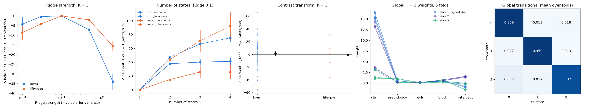{#fig-cv}

**Why K = 2.** With three states, the fit alternated between two equally good solutions:

- **Solution A:** a biased mode that ignores the stimulus;
- **Solution B:** a biased mode that still follows the stimulus.

Because the fit settled on A or B depending on its random starting values, a mouse's biased trials were sometimes
counted as engaged and sometimes not. Per-mouse "time engaged" therefore depended on the random start (ρ = 0.42
between per-mouse values from two seeds). The four-state structure
of Mohammadi et al. explains this: with three states, the model cannot represent both kinds of bias.

With two states, engaged vs disengaged, the results were identical across seeds. Each mouse's engaged state is its
higher-stimulus-weight state.

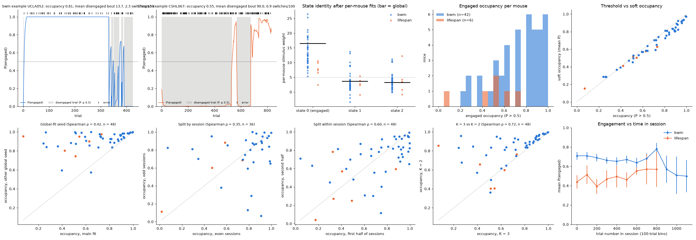{#fig-k3}

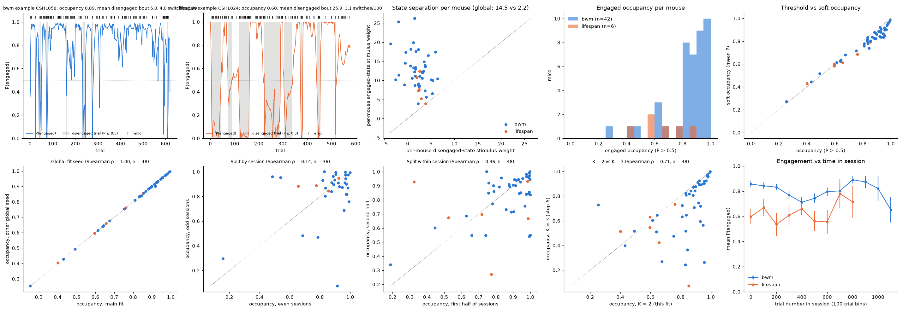{#fig-k2}

**Metrics** (all per mouse):

- **Time engaged (soft occupancy):** mean posterior P(engaged) over the mouse's trials. The posterior is the
  model's probability, given the mouse's whole session of choices, that it was in the engaged state on that trial.
- **Stimulus following:** stimulus weight of the mouse's engaged state. This is the logistic-regression slope on
  signed contrast: a weight of 12 means that going from 0 to 100 % contrast on the right raises the log-odds of a
  rightward choice by 12. Higher means choices follow the stimulus more sharply.
- **Lapse proxy** (descriptive, in figures): error rate on 100 % contrast trials.

Bout length and switch rate were too unreliable to test. Reliability was measured with the intraclass correlation
(ICC): agreement between a mouse's values from different sessions or session halves, from 0 (none) to 1
(perfect).

### Exploratory age effects

In exploration mice, age showed no gradual effect within BWM (92–454 days). Lifespan mice had lower time engaged
(0.60 vs 0.83) and weaker stimulus following (7.4 vs 12.1). Within the 6 lifespan mice, both fell with age. Lifespan
mice were less engaged from the first trials of a session, which makes satiety unlikely to be the main
explanation. Time engaged was unrelated to RT variability. These exploratory results rest on 6 lifespan mice.

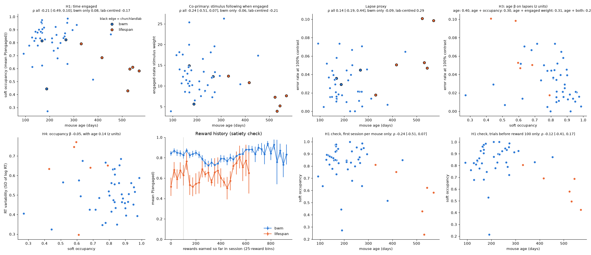{#fig-explore}

A model-free check examined easy trials (contrast ≥ 25 %) in the first 20–90 trials of each session. These trials
fall in the unbiased 50:50 block, so no block prior is involved. Lifespan mice were less accurate from the first
20 trials, with no difference in reaction time.

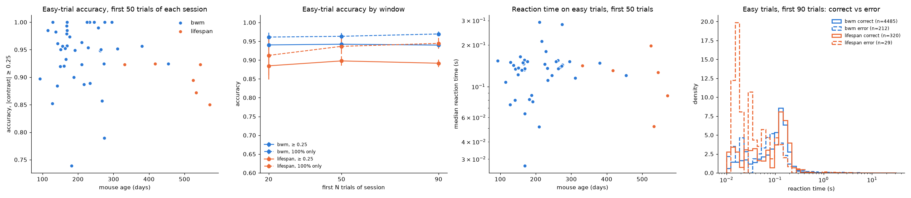{#fig-modelfree}

**Revised question.** Do old (lifespan) mice spend less time engaged and follow the stimulus less when engaged, and
within the old cohort, do these measures decline with age?

## Locked analysis plan

The plan was locked before any confirmation data were used. The metric code was frozen and identified by hash.

**Model.** K = 2 GLM-HMM, fit globally on the 110 confirmation mice, then per mouse.

**Precondition.** The fit must contain one global state with stimulus weight > 5 and one below. The threshold of
5 lies between the typical engaged (12–15) and disengaged (≈ 2) weights in the exploration fits.

**Primary tests.** A fixed sequence, each one-sided at α = 0.05; testing stops at the first non-significant result.
The plan stated that tests were ordered by expected power, but C2a (estimated power 0.71) was placed before C1b
(0.95). This was a planning error, and it is why C1b was never evaluated.

1. **C1a.** Time engaged, lifespan < BWM (Mann–Whitney U).
2. **C2a.** Time engaged falls with age within lifespan (Spearman ρ, permutation test).
3. **C1b.** Stimulus following, lifespan < BWM.
4. **C2b.** Stimulus following falls with age within lifespan.

**Add-on model-free test (evaluated regardless of the sequence).** C3: easy-trial accuracy in the first 90 trials,
lifespan < BWM. C3 was tested at its own α = 0.05, so the family-wise error rate across the primary sequence and C3
is not controlled at 0.05; its p-value (0.0056) would survive a Bonferroni correction for two families (α = 0.025).

**Trial inclusion.** No response-time filter was applied. All trials were used except no-go trials (0.4 %),
including trials in which the first wheel movement came before stimulus onset. Zang et al.'s 0.08–2 s
response-time window was not used; see the sensitivity analysis under Post-hoc analyses.

**Risks foreseen before locking:**

- the lifespan ages cluster at 520–600 days, giving C2 modest power (0.71 if ρ = −0.6);
- the C1 tests are confounded by lab and cohort.

## Results of confirmatory analysis

The precondition held: the global fit had an engaged stimulus weight of 13.8 and a disengaged weight of 2.2.

- **C1a was confirmed.** Lifespan mice spent less time engaged than BWM mice (0.61 vs 0.80, p = 1.1 × 10⁻⁵).
- **C2a was not.** The within-lifespan age trend pointed the same way, but did not reach significance
  (ρ = −0.45, p = 0.065).
- **C1b and C2b were not evaluated** because the sequence stopped at C2a. Stimulus following was nonetheless
  lower in lifespan mice (descriptively 7.0 vs 12.0).
- **C3 was confirmed.** The model-free test agreed with C1a: lifespan mice were less accurate on easy early
  trials (0.86 vs 0.93, p = 0.006). Most of this gap comes from trials with movement before stimulus onset
  (see the sensitivity analysis).

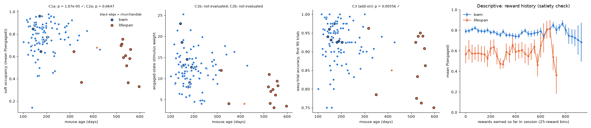{#fig-confirm}

## Post-hoc analyses

These analyses were run after the confirmatory tests. They are exploratory and do not change the locked results.

**Sensitivity to anticipatory trials.** For each filter, the model was refit on the confirmation mice and the
lifespan − BWM differences recomputed (@tbl-sensitivity, @fig-sensitivity).

- **Time engaged:** the gap held when trials with first movement before stimulus onset were removed (−0.14,
  p = 0.001) and under Zang's 0.08–2 s filter (−0.22, p = 5 × 10⁻⁵), against −0.20 in the locked analysis. It also held
  within the Churchland lab (−0.17 and −0.23), comparing lifespan mice with younger BWM mice from the same lab.
- **Early easy-trial accuracy (C3 metric):** the gap shrank from −0.066 to −0.013 once early-movement trials were
  removed, and to −0.042 under the 0.08–2 s filter. The filters differ because Zang's window is measured to response
  completion, so many trials whose movement started early still pass it.
- **Stimulus following:** the gap shrank (−5.0 to −3.0 and −2.9). These p-values are descriptive only: C1b was
  never evaluated under the locked sequence.
- **Conclusion:** early movement does not account for the time-engaged difference. It accounts for most of the C3
  gap when trials with movement before stimulus onset are removed, but under Zang's filter about two-thirds of the
  gap remains (−0.042 of −0.066, p = 0.005).

| Filter | Trials kept, median per mouse (lifespan / BWM) | Time engaged, Δ median (p) | Same, Churchland lab only | Easy-trial accuracy, Δ median (p) | Stimulus following, Δ median (p) |
|---|---|---|---|---|---|
| none (locked) | 100 % / 100 % | −0.20 (1 × 10⁻⁵) | −0.23 (2 × 10⁻⁴) | −0.066 (0.006) | −5.0 (1 × 10⁻⁵) |
| first movement ≥ stimulus onset | 85 % / 89 % | −0.14 (0.001) | −0.17 (0.005) | −0.013 (0.039) | −3.0 (4 × 10⁻⁴) |
| response time 0.08–2 s (Zang) | 85 % / 87 % | −0.22 (5 × 10⁻⁵) | −0.23 (8 × 10⁻⁴) | −0.042 (0.005) | −2.9 (4 × 10⁻⁴) |

: Post-hoc sensitivity of lifespan − BWM differences (13 vs 97 mice; Churchland lab 12 vs 8). One-sided Mann–Whitney p, not corrected, not confirmatory. Stimulus-following p-values, including the unfiltered row, are descriptive: C1b was not evaluated in the locked sequence. {#tbl-sensitivity}

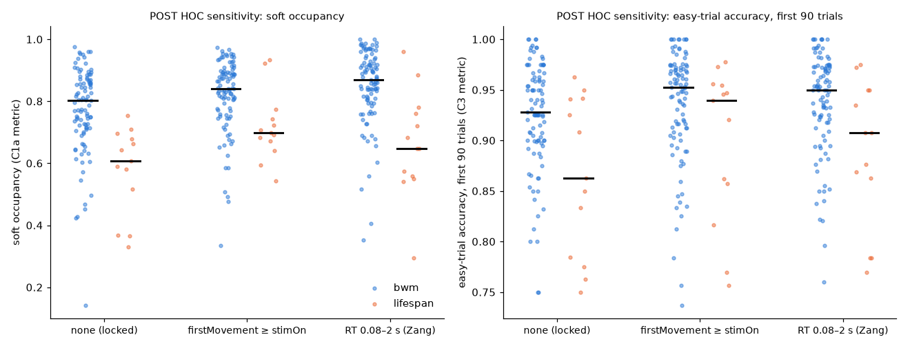{#fig-sensitivity}

**Tail of inaccurate old mice.** Even after early-movement trials were removed, 5 of 13 lifespan mice stayed below
0.87 accuracy on early easy trials (0.76–0.86; BWM: 11 of 97; the 0.87 cutoff was chosen post hoc). Four of the five
have weak engaged states (engaged weight < 5), and the tail is not graded with age within lifespan (ρ ≈ 0). The
tail includes the only lifespan mouse not from the Churchland lab, so it is not purely a feature of that lab. Accuracy and
engaged-state weights are computed from the same choices, so their overlap is partly by construction; across BWM
mice, filtered accuracy and engaged weight are similarly related (ρ = 0.41).

**State comparability.** The lifespan engaged state is weaker. These figures use all 158 mice, combining the
per-mouse fits from the exploration and confirmation global fits (confirmation mice alone: 7.0 vs 12.0):

- median engaged weight 7.3 vs 12.0;
- median separation from the disengaged state 3.7 vs 9.9;
- in 6 of 19 lifespan mice (32 %), compared with 6 of 139 BWM mice (4 %), the engaged state barely follows the
  stimulus.

"Time engaged" therefore does not mean the same thing in both groups. To check that C1a is not driven by mice whose
"engaged" label is weak, we excluded confirmation mice with engaged weight below 5 or below 7 (@tbl-weak). The gap
was unchanged. Within each cohort, time engaged rises with engaged weight (ρ = 0.48 BWM, 0.43 lifespan).

| Mice kept | Lifespan vs BWM | Time engaged, medians | AUC | p (one-sided) |
|---|---|---|---|---|
| all (locked C1a) | 13 vs 97 | 0.61 vs 0.80 | 0.14 | 1.1 × 10⁻⁵ |
| engaged weight ≥ 5 | 8 vs 92 | 0.63 vs 0.80 | 0.12 | 4.5 × 10⁻⁵ |
| engaged weight ≥ 7 | 6 vs 86 | 0.65 vs 0.80 | 0.13 | 5.5 × 10⁻⁴ |

: Post hoc: C1a after excluding confirmation mice with weak engaged states. One-sided Mann–Whitney U; not corrected, not confirmatory. {#tbl-weak}

**Age-matched comparison.** Five lifespan mice (318–417 days) share an age window with six BWM mice (334–454 days).
In that window both measures were inconclusive. Median time engaged was 0.68 vs 0.77, and median stimulus
following 10.8 vs 16.0, but the ranges of both overlap (two lifespan mice reach 11.9–12.4 in stimulus following and
one BWM mouse is at 10.4). The window combines exploration and confirmation mice.

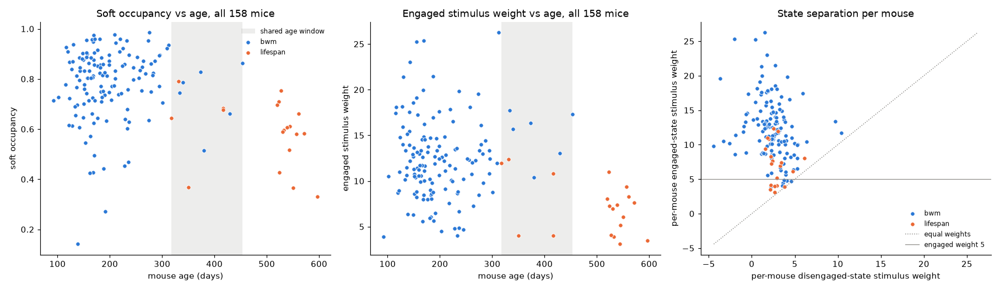{#fig-posthoc}

**Timing.** Lifespan mice's errors on easy early trials began at or before stimulus onset (median reaction time on
errors −0.02 s at 100 % contrast). Younger BWM mice from the same lab moved before stimulus onset as often as
lifespan mice (15.6 % vs 15.5 % of trials; other labs 9 %). In this task the mouse must hold the wheel still for a
quiescence period before the stimulus appears, and any movement restarts that wait. Lifespan sessions waited longer
from trial start to stimulus (median 0.97 s vs 0.69–0.73 s), consistent with more restarts (@fig-timing).

## Discussion

The GLM-HMM gives a clear group result: old (lifespan) mice
spend less of the session in a stimulus-driven state. This difference survived removing anticipatory trials and
applying the 0.08–2 s response-time filter, and it held within one lab. The model-free early-trial test (C3) also
came out significant, but post hoc much of it was driven by wheel movements that began before stimulus onset (most
of the gap under one filter, about a third under the other). That pattern is shared by younger mice from the same
lab, so C3 is weaker support than it first appeared.

What it does not show is a graded effect of ageing:

- there was no age trend within BWM mice up to 454 days;
- the within-lifespan trend was not confirmed;
- in the small age-matched window (5 vs 6 mice), neither time engaged nor stimulus following clearly differed.

The difference may therefore reflect the lifespan cohort (lab, year, rig, training history) as well as age; the
small age-matched comparison cannot separate the two.

The post-hoc checks also refine what "disengaged" means here:

- **Weaker engaged states.** Descriptively (C1b was not tested), older mice's engaged states follow the stimulus
  less sharply.
- **Early movement.** Their easy-trial errors begin at or before stimulus onset, but early movement is equally
  common in younger mice from the same lab. The longer pre-stimulus waits in lifespan sessions are consistent with
  more restarts of the quiescence timer.
- **A tail of inaccurate mice.** 5 lifespan mice stayed inaccurate even when they waited for the stimulus, and 4 of
  them had weak engaged states. The cutoff was chosen post hoc, so this is a lead for future work, not a result.
- **RT variability.** In the exploration mice (6 lifespan), time engaged did not explain RT variability, so the
  variability effect reported by Zang et al. (2026) may be separate from disengagement.

**Caveats.**

- **Time engaged is only moderately reliable** (ICC 0.39 between sessions, 0.50 between session halves). Engagement varies from day to day.
- **Weaker engaged states.** The engaged state is weaker in lifespan mice, so occupancy is not strictly comparable
  between groups.
- **Software limit.** NeMoS 0.2.9 ignores transition priors, and its transitions cannot depend on inputs. The
  input-driven model of Mohammadi et al. was therefore not reproduced.
- **Motivation.** Water restriction, body weight and training history are not in the dataset.
- **Rig settings unverified.** Quiescence settings and the logged stimulus-trigger times exist only on the remote
  database and were not compared.

**Lessons for future AI-assisted analyses.**

- **Check identifiability before testing.** For latent-state models, check state identifiability and the
  reliability of per-mouse metrics across seeds before any group comparison. This check changed K from 3 to 2.
- **Order a fixed sequence by robustness, and check the order against the stated rule.** Put the most robust tests
  first. Here the plan claimed a power ordering it did not follow: an underpowered within-cohort test placed second
  blocked a clear group difference (C1b).
- **Verify software options.** Read the source for priors and other settings. The Dirichlet prior in NeMoS 0.2.9 is
  silently ignored.
- **Add a model-free check, and give it the same sensitivity checks as the model.** Here C3 was mostly driven by
  trials with early wheel movement.

## Statistical information

| Test | Figure | Comparison | Statistic | df / n | p (one-sided) | Effect size |
|---|---|---|---|---|---|---|
| C1a Mann–Whitney U | @fig-confirm | time engaged, lifespan < BWM | U = 171 | 13 vs 97 | 1.1 × 10⁻⁵ | AUC 0.14 (medians 0.61 vs 0.80) |
| C2a Spearman ρ, permutation (10,000) | @fig-confirm | time engaged vs age, lifespan | ρ = −0.45 | n = 13 | 0.065 (n.s.) | ρ = −0.45 |
| C1b Mann–Whitney U | @fig-confirm | stimulus following, lifespan < BWM | not evaluated (fixed sequence) | 13 vs 97 | — | descriptive AUC 0.13 (7.0 vs 12.0) |
| C2b Spearman ρ, permutation | @fig-confirm | stimulus following vs age, lifespan | not evaluated | n = 13 | — | descriptive ρ = −0.18 |
| C3 Mann–Whitney U (add-on) | @fig-confirm | easy-trial accuracy, first 90 trials, lifespan < BWM | U = 356 | 13 vs 97 | 0.0056 | AUC 0.28 (medians 0.86 vs 0.93) |

AUC = U / (n₁n₂), the probability that a random lifespan mouse scores higher than a random BWM mouse (0.5 = no
difference).

## Supplementary figure

{#fig-timing}

## References

- Ryan M. B., Ye L., Churchland A. K. (2026). Understanding decision-making across the lifespan needs theoretical
  neuroscience. arXiv:2603.02461.
- Ashwood Z. C. et al. (2022). Mice alternate between discrete strategies during perceptual decision-making.
  *Nature Neuroscience* 25:201–212.
- Mohammadi Z., Ashwood Z. C., Pillow J. W. (2025). Identifying the factors governing internal state switches during
  nonstationary sensory decision-making. *Nature Communications*, doi:10.1038/s41467-025-66738-0.
- Zang F., Khanal A., Förster S., International Brain Laboratory, Churchland A. K., Urai A. E. (2026). Age-related
  changes in behavioural and neural variability in a decision-making task. *Nature Communications*,
  doi:10.1038/s41467-026-74227-1.
- International Brain Laboratory et al. (2021). Standardized and reproducible measurement of decision-making in
  mice. *eLife* 10:e63711.
