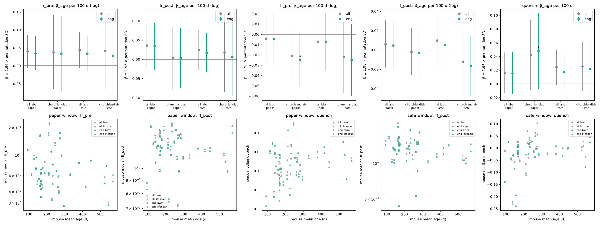
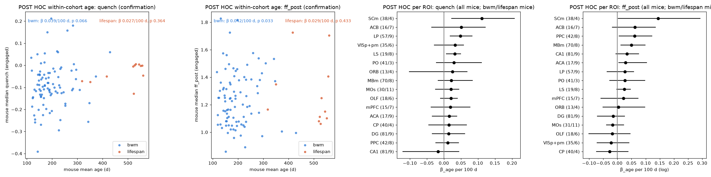

## Original question

> Do older mice show weaker quenching only because they are disengaged more often, or also when they are engaged?

During the analysis the user extended this to the other neural metrics of Zang et al.:

> For firing rate, Fano factor (pre- and post-stimulus) and quenching: compare engaged and disengaged trials, then
> check whether the age effects in Zang et al. still hold using engaged trials only.

## Introduction

**Variability quenching.** Trial-to-trial spike-count variability, measured by the Fano factor (FF, variance divided
by mean), falls at stimulus onset across many cortical areas and species (Churchland et al. 2010). Zang et al. (2026)
recorded mice of different ages in the International Brain Laboratory (IBL) visual decision task. They report three
things in older mice:

- higher firing rates overall;
- a higher post-stimulus FF;
- weaker stimulus-induced quenching (post − pre FF less negative), most clearly in visual and motor cortex,
  striatum and thalamic nucleus LP.

They found no age effect on pre-stimulus FF.

**Engagement.** Mice in this task switch between an engaged, stimulus-driven strategy and disengaged, biased
strategies (Ashwood et al. 2022). A companion analysis of the same dataset fitted a two-state GLM-HMM per mouse.
It found that older mice spend less time in the engaged state, and that their engaged state is weaker.

Disengaged trials might well show less quenching, since the stimulus matters less to the animal on those trials. If
so, the age effect on quenching could simply reflect older mice being disengaged more often. This report tests that.

**Data.** `ibl_aging_zang2025` v1.0.0 is a local repackaging of the OpenAlyx release used by Zang et al. It has 158
mice and 497 sessions:

- **bwm cohort:** 139 mice, 92–461 days old (Brain Wide Map sessions, 12 labs);
- **lifespan cohort:** 19 mice, 317–597 days old (mostly one lab).

The data hold only units that pass the three IBL single-unit quality metrics. Per-trial P(engaged) comes from the
companion GLM-HMM, which was fitted separately on exploration and confirmation mice.

Age is confounded with cohort, lab, recording year, probe type and the regions sampled. One lab recorded both
cohorts, which gives a within-lab contrast (bwm 140–270 d vs lifespan 317–597 d).

## Refinement of the question

### Split, units and trials

Mice were split 30/70 into exploration (48) and confirmation (110) sets. The split was stratified by lab and is the
same as the companion analysis. Neurons were selected as in Zang et al.:

- regions: 16 regions of interest (ROIs) built from Beryl areas;
- task-window firing rate > 1 Hz;
- presence ratio > 0.95.

Trials needed complete events and a response time of 0.08–2 s. All trials were kept. The paper's first-400 cut was
a sensitivity check and changed nothing (@fig-pilot, top right).

{#fig-split}

### Metrics

**Firing rate (FR)** is the mean spike count in a 100 ms window divided by 0.1 s.

**FF** is the mean-subtracted Fano factor of Zang et al., following Churchland et al. 2011:

- each trial's spike count in a 100 ms window minus the mean count for its signed-contrast condition (9 conditions);
- the variance of these pooled residuals, divided by the mean count.

**Windows:** pre-stimulus [−0.10, 0] s and post-stimulus [0.16, 0.26] s around stimulus onset. Quench = post FF −
pre FF; negative values mean quenching.

**Change from the paper:** the residual variance divides by (n − number of conditions). Each condition mean uses up
one degree of freedom, and this matters for the small trial subsets used below. At about 400 trials it is
negligible.

{#fig-metric}

### Diagnostics that shaped the plan

**FF depends on trial count.** Median FF rises with the number of trials used (@fig-pilot, top), because more
trials span more session time and slow drift adds variance. So every comparison between trial sets uses the same
number of trials, drawn at random 20 times and averaged.

**Engaged vs disengaged comparisons are confounded by time in session.** This part is "Part A" below. Only 20 bwm
and 7 lifespan exploration sessions had at least 20 disengaged trials. Engaged trials from early and late in a
session differ from each other about as much as engaged and disengaged trials do, even though the state is the same
(placebo, @fig-pilot bottom). Part A was therefore kept descriptive. It showed no consistent state effect: on
disengaged trials quenching was slightly weaker in bwm (+0.035) but slightly *stronger* in lifespan sessions
(−0.045).

{#fig-pilot}

**The paper's post window mostly follows movement.** Median first movement comes 0.14 s (bwm) or 0.12 s (lifespan)
after stimulus onset, and 84% of trials move before the post window ends. On engaged bwm trials, most of the FF drop
in that window is tied to movement (@fig-move): early movers show it, late movers barely do.

We therefore added a movement-safe variant: post window [0.02, 0.12] s, using only trials whose first movement came
after 0.12 s. It keeps about 70% of trials and quenches as strongly as other early windows. It was chosen on bwm mice
only, without looking at age.

{#fig-move}

### Age effects on engaged trials, exploration set

Each neuron's metrics were computed on two trial sets of the same size:

- **engaged:** P(engaged) > 0.8;
- **all:** trials of any state, which is what the paper's analysis sees.

The sets have 150 trials (paper windows) or 100 trials (movement-safe window). The age effect, β_age, is the OLS
slope of the metric on mouse mean age (per 100 days), with ROI fixed effects. FR and FF are on a log scale, as in
the paper.

The mouse is the independent unit: p-values come from permuting age across mice, with each mouse's neurons kept
together. Zang et al. treated neurons as the unit, which gives much narrower intervals.

In exploration, β_age on engaged trials was almost the same as on all trials for every metric (@fig-explore). The
age effects themselves were weak at the mouse level (z ≤ 1.7).

{#fig-explore}

### Revised question

> Restricted to engaged trials, with equal trial counts, are the age effects of Zang et al. on quenching, firing rate
> and Fano factor still present? And how much of each age effect disappears when disengaged trials are removed?

## Locked analysis plan

All tests use confirmation mice and engaged trials (P(engaged) > 0.8, equal N per neuron). The statistic is β_age
with ROI fixed effects, and p-values come from 10,000 permutations of age across mice.

**Primary family Q** (Holm correction across 3 tests; one-sided, less quenching with age):

| test | window | trials per neuron | scope |
| --- | --- | --- | --- |
| C1 | paper | 150 | within-lab (one lab, both cohorts) |
| C2 | paper | 150 | all labs |
| C3 | movement-safe | 100 | all labs |

**Secondary family F** (Holm correction across 4 tests; paper windows, all labs; added by the user):

| test | metric | alternative |
| --- | --- | --- |
| F1 | pre-stimulus FR | one-sided, higher with age |
| F2 | post-stimulus FR | one-sided, higher with age |
| F3 | post-stimulus FF | one-sided, higher with age |
| F4 | pre-stimulus FF | two-sided (the paper found no effect) |

**Mediation (descriptive).** Δ = β_all − β_eng is the part of the age slope that disappears when disengaged trials
are removed. It is estimated with a 95% mouse-bootstrap CI, using the same neurons in both trial sets.

**Interpretation rules, fixed in advance:**

- "Also when engaged" holds if any Q test is significant.
- "Not explained by disengagement" holds if, in addition, the upper bound of C2's Δ is below 0.5 × β_all.

An earlier rule based on the ratio β_eng/β_all was replaced before unblinding. On exploration mice the ratio's CI was
uninformative (−1.1 to 2.5) because β_all's CI included 0.

## Results of confirmatory analysis

All three quenching tests were significant: quenching is weaker in older mice on engaged trials.

| test | β_age per 100 d | z | Holm p |
| --- | --- | --- | --- |
| C1, within-lab (18 mice) | 0.029 | 2.4 | 0.011 |
| C2, all labs (100 mice) | 0.031 | 3.0 | 0.011 |
| C3, movement-safe window | 0.021 | 2.4 | 0.011 |

Removing disengaged trials did not reduce the effect. For C2, Δ = −0.003 (95% CI −0.009 to 0.002) against
β_all = 0.029, so the pre-set criterion is met.

In the secondary family, post-stimulus FF rose with age (F3: z = 2.8, Holm p = 0.020), as Zang et al. report. Pre-
and post-stimulus firing rate were in the paper's direction but not significant (z ≈ 1.2, Holm p = 0.34).
Pre-stimulus FF showed no effect (p = 0.42), which is consistent with the paper but doesn't prove absence.

{#fig-confirm}

For every metric, window and scope, Δ was within ±0.005 of zero. Restricting to engaged trials left every age slope
essentially unchanged.

## Post-hoc analyses

These were requested by the user after unblinding and are not part of the locked plan. They have no multiplicity
correction.

**Within cohort (confirmation mice, engaged trials).** Within bwm alone (89 mice, 116–429 d), quenching weakened
with age:

- paper window: β = 0.039 per 100 d, two-sided p = 0.066;
- movement-safe window: β = 0.057, p = 0.003.

Post-stimulus FF rose (β = 0.042, p = 0.033). Within lifespan alone (11–12 mice) the slopes pointed the same way but
were not significant. So the effect is not only a difference between cohorts; it is graded within the younger
cohort too.

**Per ROI (all 158 mice, paper windows, engaged trials; ROIs with at least 3 mice per cohort).** β_age for quenching
was positive in 15 of 16 ROIs, and its CI excluded 0 in LP, LS and SCm. Zang et al. named LP and LS among their
strongest regions. Post-FF effects were more mixed across regions.

{#fig-posthoc}

## Discussion

**Answer.** Older mice show weaker quenching also when they are engaged. The age effect on quenching is the same on
engaged trials as on all trials, and on the few sessions where engaged and disengaged trials could be compared
directly, disengaged trials did not quench less in older mice. More time spent disengaged therefore cannot explain
the effect. The higher post-stimulus FF also holds on engaged trials. The higher firing rate does not reach
significance at the mouse level.

**Relation to prior work.**

- The quenching and post-FF effects replicate Zang et al. under stricter conditions: mice rather than neurons as the
  unit, engaged trials only, equal trial counts.
- They survive a window that excludes movement.
- The FR effect did not: Zang et al. reported it at the neuron level, and with mice as the unit its slope is
  positive but within the permutation spread.

**Caveats.**

- **Age and cohort are confounded.** The post hoc within-bwm slope supports a graded age effect, but lab, rig and
  region mix still differ between cohorts.
- **"Engaged" differs by age.** In older mice the engaged state has a weaker stimulus weight, so "engaged" is a
  model-defined state, not an equal level of attention.
- **Part A is weak.** Only 7 lifespan sessions could be used, and the early-vs-late placebo showed drift as large as
  the state differences.
- **Movement.** Most of the FF drop in the paper's window is tied to movement. The movement-safe result is smaller
  (β 0.021 vs 0.031), so part of the paper-window effect may reflect movement timing, which differs with age.
- **Not independent.** Zang et al. analysed these same sessions, so the all-trial age effects are not independent
  evidence. Only the engaged-trial comparison is new.
- **Region coverage.** Lifespan mice lack several regions, and ROI fixed effects adjust only the level of each
  region, not its age slope.

**Lessons for AI-assisted analysis.**

- Check how FF depends on trial count, and use a time-in-session placebo, before comparing trial subsets.
- Check movement timing against analysis windows taken from a paper.
- Prefer a difference (Δ) over a ratio when the denominator can be near zero; that decision was made before
  unblinding.

## Statistical information

| test | figure | comparison | statistic | units (mice / neurons) | p (raw) | p (Holm) | effect size |
| --- | --- | --- | --- | --- | --- | --- | --- |
| C1 | @fig-confirm | quench vs age, within-lab, paper window | OLS β_age, ROI fixed effects; age permutation across mice (10,000), one-sided | 18 / 2,211 | 0.0038 | 0.011 | β = 0.029 per 100 d, z = 2.44 |
| C2 | @fig-confirm | quench vs age, all labs, paper window | same | 100 / 12,040 | 0.0042 | 0.011 | β = 0.031, z = 2.96 |
| C3 | @fig-confirm | quench vs age, all labs, movement-safe window | same | 100 / 12,146 | 0.0079 | 0.011 | β = 0.021, z = 2.42 |
| F1 | @fig-confirm | log pre-FR vs age | same, one-sided | 100 / 12,156 | 0.115 | 0.345 | β = 0.026 (log), z = 1.21 |
| F2 | @fig-confirm | log post-FR vs age | same, one-sided | 100 / 12,156 | 0.121 | 0.345 | β = 0.026 (log), z = 1.17 |
| F3 | @fig-confirm | log post-FF vs age | same, one-sided | 100 / 12,100 | 0.0050 | 0.020 | β = 0.028 (log), z = 2.75 |
| F4 | @fig-confirm | log pre-FF vs age | same, two-sided | 100 / 12,092 | 0.422 | 0.422 | β = 0.008 (log), z = 0.81 |
| Δ (C2) | @fig-confirm | β_all − β_eng, quench, paper window | mouse bootstrap (2,000), 95% percentile CI | 100 / 12,040 | n/a | n/a | Δ = −0.003 [−0.009, 0.002] vs β_all = 0.029 |
| post hoc | @fig-posthoc | quench vs age within bwm, paper / movement-safe window | OLS β, ROI fixed effects; permutation (5,000), two-sided | 89 / ~10,900 | 0.066 / 0.003 | none | β = 0.039 / 0.057 |
| post hoc | @fig-posthoc | post-FF vs age within bwm, paper window | same | 89 / 10,996 | 0.033 | none | β = 0.042 (log) |

Permutation tests have no degrees of freedom. Units are listed instead: mice are the units permuted, and neurons
enter the regression.

**Data and code.** `ibl_aging_zang2025` v1.0.0 (OpenAlyx tag `2025_Q3_Zang_et_al_Aging`; bwm spikes are the Brain
Wide Map 2024-05-06 sorting). GLM-HMM posteriors come from the companion analysis (K = 2, fitted with NeMoS 0.2.9).
Analysis scripts are numbered 000–006 in the project's `exploratory-analyses/` and `confirmatory-analyses/`.

## References

- Ashwood Z. C. et al. (2022). Mice alternate between discrete strategies during perceptual decision-making.
  *Nat. Neurosci.* 25, 201–212.
- Churchland M. M. et al. (2010). Stimulus onset quenches neural variability: a widespread cortical phenomenon.
  *Nat. Neurosci.* 13, 369–378.
- Churchland A. K. et al. (2011). Variance as a signature of neural computations during decision making.
  *Neuron* 69, 818–831.
- Zang F., Khanal A., Förster S., International Brain Laboratory, Churchland A. K., Urai A. E. (2026). Age-related
  changes in behavioural and neural variability in a decision-making task. *Nat. Commun.*
  doi:10.1038/s41467-026-74227-1.
