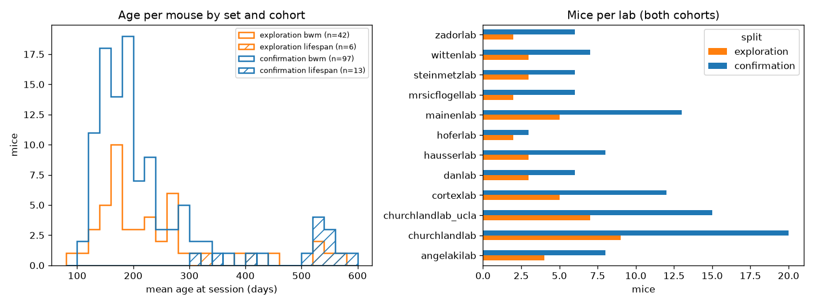
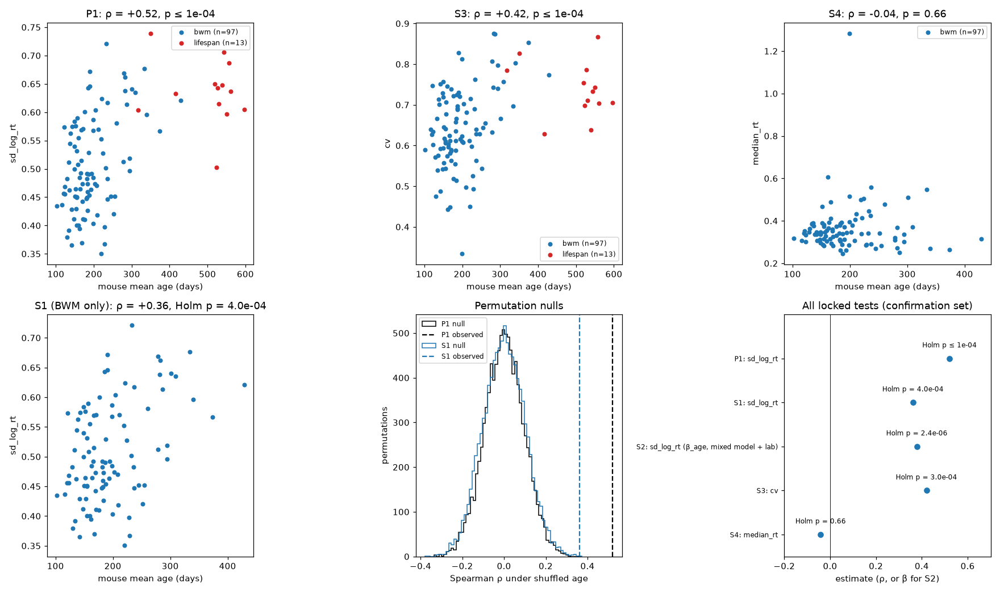
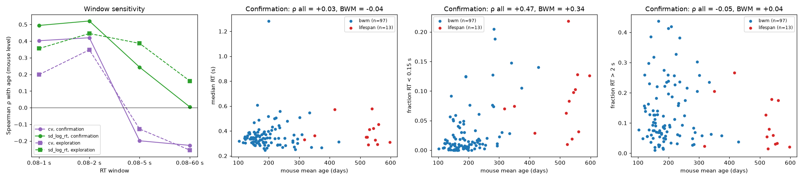

## Original question

> Does reaction time slow, or become more variable (coefficient of variation), with age?

## Introduction

Increased trial-to-trial variability of reaction time (RT) is one of the most consistent behavioural signs of
ageing in humans. A meta-analysis found that older adults' RTs are more variable than younger adults', especially
in choice-RT tasks, and that slower mean RT explains only part of this difference (Dykiert et al. 2012). Zang et al. (2026) recently tested whether this holds in mice performing the International Brain
Laboratory (IBL) visual decision task (IBL et al. 2021). They reported more variable RTs in older mice (higher
coefficient of variation, CV), and no slowing of median RT, with age treated as a continuous predictor.

We re-analysed the same sessions to ask whether the result holds under a pre-registered-style split between
exploration and confirmation, and how it depends on the choice of RT measure and trial window.

**Data.** `ibl_aging_zang2025` v1.0.0 is a local repackaging of the OpenAlyx release tagged
`2025_Q3_Zang_et_al_Aging`. It covers 158 mice and 497 sessions from 12 labs, in two cohorts:

- **BWM:** 139 mice, 92–456 days old. These are Brain Wide Map sessions.
- **Lifespan:** 19 mice, 318–597 days old, almost all from one lab.

Each session is a biased-block visual decision task. The mouse turns a wheel to report which side a grating of
varying contrast appeared on.

**Design limits that shape every result:**

- **Age is confounded with cohort.** Older animals come mostly from the lifespan cohort, which differs in lab,
  rig, recording year and probe type.
- **There is no within-mouse ageing.** A mouse's sessions typically fall within a few days of each other, so all
  age effects are comparisons between mice.
- **The mouse is the independent unit.** Sessions are nested within mice: two sessions from one mouse are not two
  independent observations of how age relates to RT. The paper's behavioural statistics treated each session as
  a data point. We summarise each mouse first, so that mice with many sessions do not count more and p-values are
  not overstated.
- **The hypothesis is not new to the data.** Zang et al. analysed all of these sessions, so our "confirmation"
  is not naive. What the split protects is our own choice of metric and parameters.

## Refinement of the question

### Data split

Mice were split 30 % / 70 % into exploration (48 mice: 42 BWM, 6 lifespan) and confirmation (110 mice: 97 BWM,
13 lifespan) sets. BWM mice were stratified by lab, and lifespan mice as one stratum. Within each stratum we used
age-ordered systematic sampling, so both sets cover the same age range. All metric and parameter choices below
were made on exploration mice only.

The reason for the split: an analysis has many free choices (which RT measure, which trials). If these are tuned
and tested on the same data, some will look good by chance. Choosing on one set and testing once on the other
keeps the final p-values honest.

{#fig-split}

### Defining reaction time

RT is defined as `response_times − stimOn_times`, following the paper. This is the time from stimulus onset
until the wheel crosses the response threshold, the point where the stimulus has moved ±35° on screen (IBL et al.
2021). In wheel units this was 0.281 rad in every exploration session, cohort and lab (@fig-rt, top left and
middle), so the RT end point is comparable across animals. RT therefore includes both the decision and the
movement needed to complete it.

The diagnostics revealed three features that matter for any variability metric:

1. **A fast mode near 0.1 s.** It appears even at zero contrast, where there is no stimulus to see, so these
   responses are anticipations: the mouse moves before it could have processed the stimulus. The mode is larger
   in lifespan mice, and the paper's lower bound of 0.08 s cuts through it.
2. **A heavy, session-specific slow tail.** RT > 2 s covers 11 % of BWM trials and 7 % of lifespan trials, and up
   to 57 % in one session.
3. **Wheel movement before stimulus onset.** This occurs in 13 % of kept BWM trials and 19 % of kept lifespan
   trials. On these trials RT partly measures a movement that had already started.

Because of these tails, a spread metric can rise with age through more anticipations or fall through fewer slow
trials, depending on how the tails are treated. We followed the paper's trial rules (first 400 trials, RT
0.08–2 s, early-movement trials kept) as the primary setting, and tested how much each rule matters below.

{#fig-rt}

### Choosing a variability metric

We compared three spread measures, each also in a per-contrast version, computed per session on kept trials
(first 400 trials, complete, RT in 0.08–2 s):

| Measure | Definition |
|---|---|
| CV (the paper's measure) | SD / mean |
| robust CV | IQR / median (the spread of the middle half of RTs, ignoring the outer quarters) |
| SD of log RT (`sd_log_rt`) | SD of log-transformed RT |
| per-contrast versions | each measure computed within each contrast, then averaged |

**Why SD of log RT.** RT distributions are skewed: a long tail of slow trials. Taking the log makes them roughly
symmetric, and a difference on the log scale is a ratio on the original scale. So SD of log RT measures relative
variability, like CV (for log-normal RTs the two are nearly equal), but is less dominated by a handful of very
slow trials. The log also stretches the fast end of the distribution, so this measure is more sensitive than CV
to very fast responses.

The SD scales with the mean (Spearman ρ = 0.86), so a raw SD would confound variability with slowness. CV removes
this coupling almost entirely (ρ = 0.06 with median RT across sessions); SD of log RT removes most of it but not
all (ρ = 0.39). Robust CV keeps the most (0.53). All measures were reliable when trials within a session were
split into halves (ρ = 0.78–0.97). Measured session-to-session within mouse, CV (ρ = 0.80) and SD of log RT
(0.74) were the most reliable. Pooled and per-contrast versions agreed closely (ρ ≥ 0.89), so differences in
contrast mix between sessions do not drive the spread measures.

{#fig-metrics}

### Parameter sensitivity

The paper fixed its trial rules in advance; we asked how much the result depends on them. We mapped the
correlation between each mouse's metric and its age over a grid of 48 settings: RT lower bound (0, 0.08 or
0.15 s), upper bound (1, 2, 5 or 60 s; 60 s is the trial timeout, i.e. no cut), early-movement trials kept or
dropped, and first 400 vs all trials. Throughout, we use the Spearman rank correlation ρ: it asks whether older
mice tend to rank higher on the metric, without assuming a straight-line relation, and a few extreme mice cannot
dominate it.

- **The paper's CV changed sign with the upper bound:** ρ ≈ +0.3 with a 2 s cut, but negative with 5 s or no
  cut.
- **SD of log RT was positive in all 48 settings,** in all mice and in BWM mice alone, peaking at the 0.08–2 s
  window (ρ = +0.45). It was weaker without an upper cut (ρ = +0.06 to +0.27, all mice), an early sign of the
  window dependence that confirmation later made clear.
- **Raising the lower bound to 0.15 s barely changed SD of log RT** (ρ = +0.45), so the effect is not just
  anticipations.
- **Median RT was weakly positive overall, and stronger within BWM** (ρ ≈ 0.3).

{#fig-grid}

### Age effects and confound checks in exploration

At the primary setting, SD of log RT rose with age across all mice (ρ = +0.45), within BWM (+0.38) and within lab
(lab-centred, +0.42). "Lab-centred" means each mouse's age and metric are expressed relative to its lab's mean,
so only differences between mice of the same lab count.

We also fitted linear mixed models on sessions. These estimate the age effect while allowing each mouse its own
baseline (a "random intercept per mouse"), which handles mice contributing different numbers of sessions. Age
and metric were z-scored, so the coefficient β reads as: one standard deviation more age goes with β standard
deviations more variability. β stayed between 0.42 and 0.48 after adding, one at a time, lab, cohort, session
accuracy, trial count, early-movement rate or median RT. The effect was present in both halves of the session.

{#fig-explore}

### Revised question

> Across mice, is older age associated with greater trial-to-trial RT variability, measured as the SD of log RT
> within the 0.08–2 s window? And is this true within the BWM cohort alone, independent of lab? Slowing was
> narrowed to a secondary question: does median RT increase with age within the BWM cohort?

## Locked analysis plan

The plan was locked before the confirmation set was opened, with the metric code frozen. It applies to the 110
confirmation mice. Trial rules: first 400 trials, complete trials (no no-go responses, all required events
present), RT in 0.08–2 s, early-movement trials kept. Each mouse's value is the mean over its sessions, and its
age is the mean age at session. Unlike the paper, we applied no session-level quality filter (> 400 trials, ≥ 90 %
correct on full-contrast trials, ≥ 3 errors). Applying it afterwards removed 5 of 349 confirmation sessions and
left every result unchanged to two decimals (`007_review_checks.csv`).

| Test | Hypothesis | Method |
|---|---|---|
| **P1 (primary)** | SD of log RT increases with age, all mice | Spearman ρ; one-sided permutation test (10,000 shuffles of age across mice); α = 0.05 |
| S1 | P1 in BWM mice only | as P1 |
| S2 | P1 adjusted for lab, sessions nested in mice | linear mixed model `sd_log_rt_z ~ age_z + lab + (1 | mouse)`; one-sided Wald test |
| S3 | the paper's CV increases with age | as P1, with CV |
| S4 | median RT increases with age, BWM only | as P1 |

How to read these tests:

- **Permutation test.** Age is shuffled at random across mice 10,000 times, and ρ is recomputed each time. This
  gives the range of ρ values expected if age had no relation to the metric. The p-value is the fraction of
  shuffles that reach the observed ρ. With 10,000 shuffles the smallest possible p is about 1 × 10⁻⁴.
- **One-sided.** Each hypothesis predicts a direction (more variability, or slower RT, with age), so only that
  direction counts as evidence. The paper used two-sided tests.
- **Holm correction.** Running four secondary tests raises the chance that one is significant by luck. Holm's
  method adjusts their p-values so the chance of any false positive among them stays at 5 %. P1 is the single
  primary test and is not corrected.

A power analysis on the exploration estimate (Fisher z) gave a power of 0.84 for P1 if the true ρ is 0.25: an
84 % chance of detecting an effect of that size. Anticipated risks were shrinkage of the effect after picking the
best of several candidate metrics, unusual lifespan mice, and the confound between age and cohort.

## Results of confirmatory analysis

**RT variability increases with age (P1 confirmed).** Across the 110 confirmation mice, SD of log RT correlated
with age at ρ = +0.52, p ≤ 1 × 10⁻⁴, the smallest p that 10,000 permutations can give. The estimate is larger
than in exploration (+0.45).

**It is not only a cohort or lab effect.** The effect held within the 97 BWM mice (S1: ρ = +0.36, Holm
p = 4 × 10⁻⁴). With lab as a fixed effect and sessions nested in mice, the age coefficient was
β = 0.38 SD per SD of age (95 % CI 0.23–0.53; S2: Holm p = 2 × 10⁻⁶).

**The paper's CV result replicates in the 0.08–2 s window** (S3: ρ = +0.42, Holm p = 3 × 10⁻⁴). This holds with
mice, not sessions, as the unit, which is a stricter test than the paper's.

**No evidence that older mice are slower.** Median RT did not increase with age within BWM (S4: ρ = −0.04,
p = 0.66; 95 % bootstrap CI −0.24 to +0.17). This matches the paper, which also found no slowing. The slowing
seen in exploration did not replicate. The interval rules out more than a weak positive relation, but not a small
one.

{#fig-confirm}

## Post-hoc analyses

These analyses were declared in the locked plan as descriptive only, with no tests, and run after confirmation.
The lower-bound check and the bootstrap interval for S4 were added at report review (`007_review_checks.py`).

**The effect depends on excluding the slow tail.** In the confirmation set, the correlation between SD of log
RT and age shrank as the upper RT bound was raised:

| Upper RT bound | ρ (SD of log RT vs age) |
|---|---|
| 1 s | +0.49 |
| 2 s | +0.52 |
| 5 s | +0.24 |
| none (60 s) | 0.00 |

In exploration the drop without a cap was already visible (+0.16) but milder; confirmation makes it clear.

CV changed sign again (+0.42 at 2 s, −0.20 at 5 s), replicating its fragility. So the age effect lives in the
body of the RT distribution (≲ 2 s), not in the slow tail. Why the slow tail hides it: trials over 2 s are few,
but their RTs range up to a minute, so they weigh heavily on any spread measure. How often they occur is unrelated to age
(ρ = −0.05), so including them adds a large source of variation between mice that has nothing to do with age.
The paper's 2 s cap therefore matters for its CV result.

**Older mice make more anticipatory responses, but these explain only a small part of the effect.** The
fraction of complete trials with RT < 0.15 s rose with age (ρ = +0.47 all mice; +0.34 BWM). Yet removing all fast
responses left most of the variability effect in place:

| RT window | ρ (SD of log RT vs age), all mice | BWM mice |
|---|---|---|
| 0.08–2 s (locked) | +0.52 | +0.36 |
| 0.15–2 s | +0.45 | +0.32 |
| 0.20–2 s | +0.41 | +0.29 |

Median RT was unrelated to age across both cohorts (ρ = +0.03).

Together these suggest that older mice spread their responses in the normal 0.15–2 s range more widely, and in
addition make somewhat more anticipatory responses.

{#fig-posthoc}

## Discussion

**Relation to prior work.** We confirm the central behavioural finding of Zang et al. (2026): RT variability
increases with age in mice performing the IBL task, while median RT does not change. Both match the paper, here
with mice rather than sessions as the unit of analysis. Three findings go beyond it:

- **The effect is not only a cohort difference.** It holds within the BWM cohort alone and after adjusting for
  lab. The paper's behavioural model had age as its only predictor.
- **It depends on the 2 s cap.** With slow trials kept, CV reverses sign and SD of log RT shows no age effect.
- **Anticipations contribute, but are not the main driver.** Older mice make more sub-0.15 s responses, but the
  effect largely survives removing them.

This parallels human ageing, where RT variability rises with age and slower mean RT explains only part of the
rise (Dykiert et al. 2012). In our mice there was no mean slowing at all, so the variability increase is not a
by-product of slower responses.

**Caveats.**

- **The result depends on the window.** The effect is strong within the 0.08–2 s window and disappears when all
  slow trials are kept. Both the paper's CV and our SD of log RT measure variability of the bulk of responses. A
  claim about "RT variability" in general would overstate the result.
- **What kind of variability.** The extra spread in older mice is mostly within the normal 0.15–2 s range, but
  RT here combines decision time and movement time, so we cannot say whether older mice decide or move more
  variably. The anticipation and lower-bound results are post hoc and untested.
- **Confounds.** Age co-varies with training duration and experience (not in the dataset). In the lifespan
  cohort it also co-varies with lab, rig, probe and recording year. S1 and S2 rule out a pure cohort or lab
  explanation, but not training history.
- **Between-mouse inference only.** Mice were not followed over time, so the effect is an association across
  individuals, not a measured change within an animal.
- **This is not an independent replication.** The sessions are the same as in the original paper. The split
  protects our metric choices, not the hypothesis.

**Lessons for future AI-assisted analyses.**

- **Check the parameter map on both sets.** A metric that stayed positive across 48 settings in 48 mice lost
  its effect without an upper cut in 110 mice; the weakening was visible in exploration but read as minor. The parameter sensitivity check should be repeated on the confirmation set, and window-dependence
  should be built into the locked claims.
- **Test the tails explicitly.** Tail rates (anticipations, slow trials) are cheap to compute and change the
  interpretation of variability metrics. They should be examined before choosing a spread measure, and an
  explanation based on one tail should be checked by removing that tail.
- **Use pre-specified descriptives.** Declaring "descriptive only" analyses in the locked plan made it possible
  to report the window-dependence honestly, without p-hacking.

## Statistical information

| Test | Figure | Comparison | Statistic | df / n | p (one-sided) | p (Holm) | Effect size |
|---|---|---|---|---|---|---|---|
| P1: Spearman rank correlation, permutation test (10,000) | @fig-confirm | age vs SD of log RT, all mice | ρ = 0.521 | df = 108 (n = 110 mice) | ≤ 1.0 × 10⁻⁴ | — (primary) | ρ = 0.52 |
| S1: Spearman rank correlation, permutation test (10,000) | @fig-confirm | age vs SD of log RT, BWM mice | ρ = 0.361 | df = 95 (n = 97) | 2.0 × 10⁻⁴ | 4.0 × 10⁻⁴ | ρ = 0.36 |
| S2: linear mixed model (REML), Wald z test | @fig-confirm | age coefficient, SD of log RT, lab fixed effect, random intercept per mouse | z = 4.85 | 349 sessions, 110 mice | 6.1 × 10⁻⁷ | 2.4 × 10⁻⁶ | β = 0.38 SD/SD (95 % CI 0.23–0.53) |
| S3: Spearman rank correlation, permutation test (10,000) | @fig-confirm | age vs CV, all mice | ρ = 0.420 | df = 108 (n = 110) | 1.0 × 10⁻⁴ | 3.0 × 10⁻⁴ | ρ = 0.42 |
| S4: Spearman rank correlation, permutation test (10,000) | @fig-confirm | age vs median RT, BWM mice | ρ = −0.041 | df = 95 (n = 97) | 0.66 | 0.66 | ρ = −0.04 |

The post-hoc and exploration correlations in @fig-grid, @fig-explore and @fig-posthoc are descriptive and were
not tested.

## References

- Zang F., Khanal A., Förster S., International Brain Laboratory, Churchland A. K., Urai A. E. (2026).
  Age-related changes in behavioural and neural variability in a decision-making task. *Nature Communications*.
  doi:10.1038/s41467-026-74227-1.
- International Brain Laboratory et al. (2021). Standardized and reproducible measurement of decision-making in
  mice. *eLife* 10:e63711.
- Dykiert D., Der G., Starr J. M., Deary I. J. (2012). Age differences in intra-individual variability in simple
  and choice reaction time: systematic review and meta-analysis. *PLoS ONE* 7(10):e45759.
