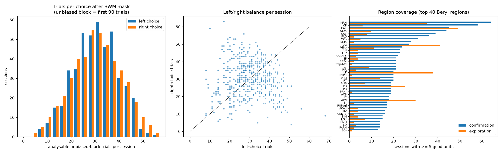
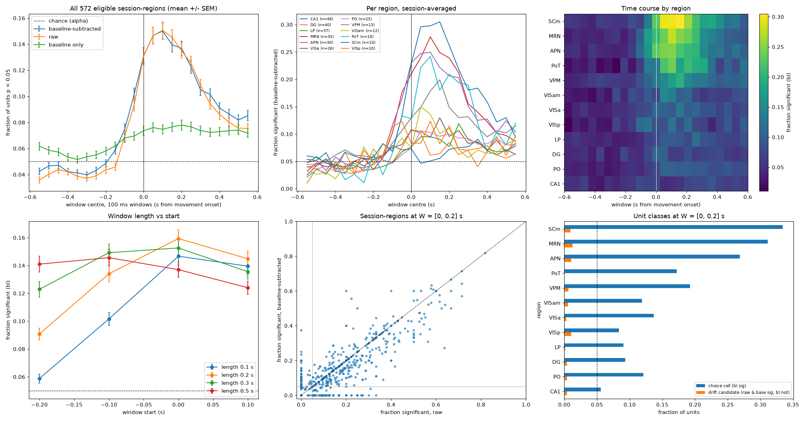
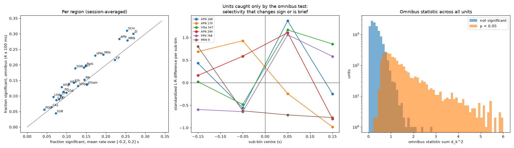
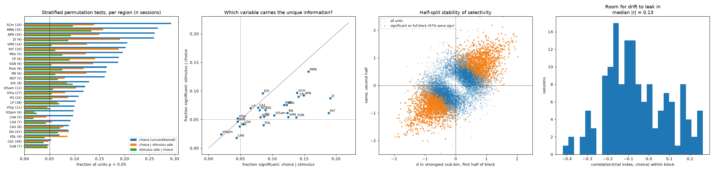
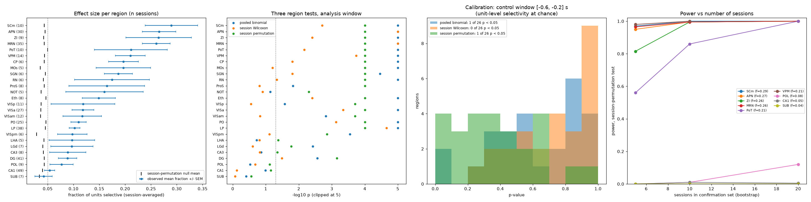
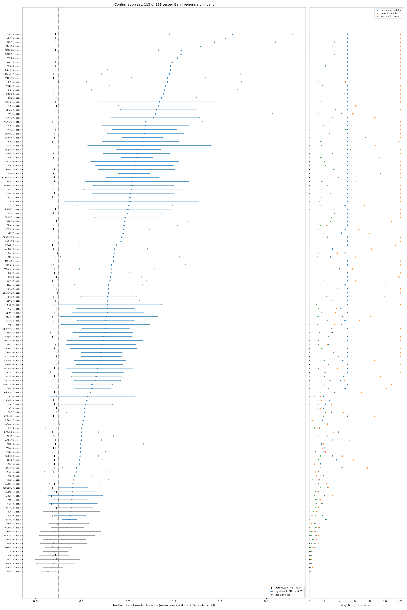
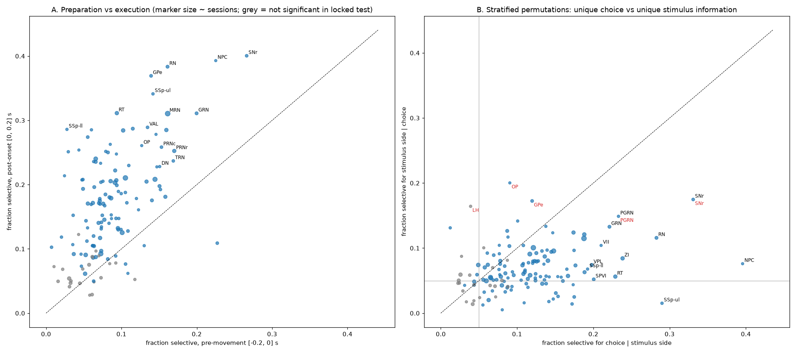
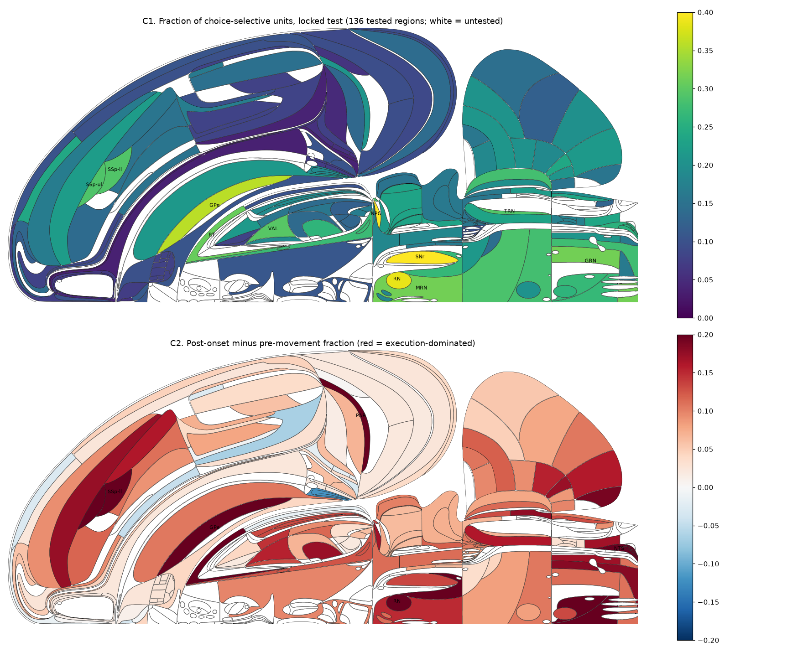
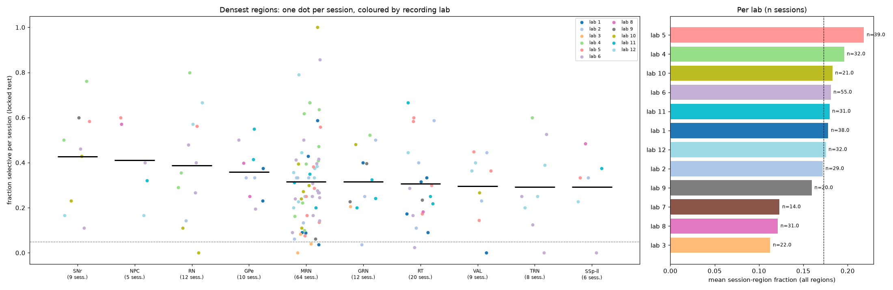

## Original question

> Using only trials from the initial unbiased block, which brain regions contain neurons whose firing rate around movement onset differs significantly between left and right choices?

## Introduction

In the International Brain Laboratory (IBL) decision-making task, a mouse sees a visual grating on the left or right and turns a wheel to bring it to the centre. The first 90 trials of every session form the *unbiased block*, in which the stimulus appears on either side with equal probability; afterwards the task alternates between blocks in which one side is favoured 80:20. The Brain Wide Map (BWM) release contains Neuropixels recordings from hundreds of sessions spanning most of the mouse brain, so it allows a single, uniform test of where the upcoming action is represented.

Two findings from the BWM and related work motivate the question. First, activity related to movement is remarkably widespread: when the wheel moves, firing changes in nearly every recorded region. Second, activity that distinguishes *which way* the animal moves, the choice, is also broadly distributed but appears to be concentrated in motor-related structures. Restricting the analysis to the unbiased block removes the block prior as a confound: the animal has no reason to expect one side over the other, so any left-right difference in firing cannot reflect a bias signal carried over from a biased block. The cost is a small number of trials per session.

## Refinement of the question

### Data, replicates and split

The analysis used the local BWM derived dataset (459 sessions, 699 insertions, 75,395 good units, 139 mice). Trials were kept if they belonged to the unbiased block (block prior of 0.5), passed the standard BWM trial mask, had a left or right choice, and had a detected movement onset. Every session's unbiased block is exactly its first 90 trials; after the mask a typical session keeps about 60, roughly 25 on the rarer side (@fig-census). Units were assigned to Beryl atlas regions; the 13% of good units whose atlas label is a coarse parent structure have no Beryl label and were dropped.

Statistical replicates are *sessions*: a session's population of units within one Beryl region is one replicate. To avoid tuning the analysis on the data used for inference, sessions were split before exploration. The 67 repeated-site sessions plus 20 randomly chosen others formed the exploration set (87 sessions); the remaining 372 formed the confirmation set, which was not touched until the plan was locked.

{#fig-census}

### What selectivity looks like in single neurons

Rasters and PSTHs aligned to movement onset and split by choice (@fig-rasters) showed two kinds of unit that a naive metric would treat identically. Some units, such as the pretectal (APN) units in the bottom row, fire differently for left and right choices in a burst locked to movement onset. Others, such as the top-left visual cortical unit, differ between choices by a constant offset across the whole trial, including well before the stimulus. The second pattern cannot be caused by the choice; it arises when a slow drift in firing rate coincides with an uneven distribution of choices over the block. This observation drove the metric design.

{#fig-rasters}

### The per-unit metric

For every unit and trial we take the firing rate in a window around movement onset and subtract the rate in the 0.3 s before stimulus onset, when the task requires the mouse to hold the wheel still. The left-right difference of this baseline-subtracted rate, divided by its across-trial standard deviation, is the unit's selectivity. @fig-metric shows the construction for a genuine choice cell and for the drifting unit: the raw window rate calls both selective, the baseline difference exposes the drift, and the baseline-subtracted difference keeps only the first.

{#fig-metric}

### Choosing the window

Running the metric on all 15,906 exploration units with no unit selection, in 100 ms windows sliding from -0.6 to +0.6 s, gave a clean time course (@fig-grid). Before -0.2 s the fraction of significant units equals the nominal false-positive rate of 5%, confirming the calibration of the permutation test. It rises from -0.15 s, peaks in the first 100 to 200 ms after movement onset and decays over the following half second. Raw and baseline-subtracted metrics give the same population fractions: drifting units are about 1% of the total, so baseline subtraction is a cheap safeguard rather than a large correction. The ranking of regions was stable across windows.

{#fig-grid}

The user asked for every neuron involved in the turn, whether it prepares or executes the movement, so a single wide window from -0.2 to +0.2 s was chosen. A wide window has a trap: a unit whose selectivity reverses sign between preparation and execution averages to nothing. The final per-unit statistic is therefore an *omnibus*: the window is split into four 100 ms sub-bins, and the statistic is the sum of squared standardized differences across them. It detects a difference anywhere in the window in either direction. On the exploration set it recovered 17.5% of units against 14.8% for the mean rate, and the 5% of units it alone catches show sign-changing or brief selectivity (@fig-omnibus).

{#fig-omnibus}

### Confounds

Choice agrees with stimulus side on 87% of trials. Permuting choice labels only within trials of the same stimulus side tests for choice information beyond the stimulus; the mirror test permutes stimulus side within choice. Choice retained most of its signal (11.3% of units versus 16.2% unconditioned), while stimulus side given choice was near chance (6.7%) except in the midbrain reticular nucleus (@fig-confounds). Splitting the block into halves, the sign of a unit's selectivity measured on the first half predicted the second half in 90% of units significant on the first half alone, and the per-unit differences correlated at r = 0.60 across all units. Selectivity is a stable property of the neuron over the block.

{#fig-confounds}

### Revised question

Which Beryl regions contain, in the initial unbiased block, a larger fraction of units than expected by chance whose baseline-subtracted firing in the 400 ms around movement onset differs between left and right choices, with sessions as replicates?

## Locked analysis plan

The plan below was fixed before the confirmation set was analysed.

- **Trials**: unbiased block, BWM trial mask, left or right choice, movement onset present.
- **Units**: BWM good units with a Beryl label. A session-region replicate needs at least 5 units; a region is tested if it has at least 5 such sessions.
- **Per unit**: omnibus statistic over four 100 ms sub-bins in [-0.2, 0.2] s around movement onset, each baseline-subtracted (0.3 s pre-stimulus). 1000 choice-label permutations per session, shared by all units and probes of the session and seeded from the session identifier. A unit is *selective* if its statistic exceeds the 95th percentile of its own null.
- **Per region (primary)**: the mean over sessions of the fraction of selective units, against a null of 100,000 draws that combine one random permutation per session. One-sided p, Benjamini-Hochberg across tested regions, q < 0.05 defines the answer set. Effect size: mean fraction with a bootstrap 95% confidence interval over sessions.
- **Sensitivity**: pooled binomial and one-sided session Wilcoxon, each Benjamini-Hochberg corrected separately.
- **Post-hoc, descriptive only**: pre-movement [-0.2, 0] versus post-onset [0, 0.2] fractions; choice conditioned on stimulus side; brain maps; per-lab breakdown.

On the exploration set the primary test found 22 of 26 regions significant, the binomial 20 and the Wilcoxon 12; on a pre-movement control window all three found 0 or 1 of 26, as expected at the 5% level (@fig-design). Bootstrap power at confirmation-set session counts was near 1 for regions with a fraction of 0.2 or more and at least 12 sessions, and below 0.5 for fractions under 0.09 or fewer than 7 sessions.

{#fig-design}

## Results of confirmatory analysis

The confirmation set contributed 368 sessions with at least one eligible session-region, 1,924 session-regions and 47,917 units. 136 Beryl regions had at least five eligible sessions and were tested. **115 of them were significant** at q < 0.05 (@fig-result). The pooled binomial agreed on 129 of 136 regions; the Wilcoxon agreed on 88, missing only regions the primary test called significant, consistent with its lower power. The permutation null mean was 0.04 to 0.05 in every region.

Choice-selective neurons are therefore present in most of the brain, but their density varies about tenfold. The densest populations are in the descending motor system: substantia nigra pars reticulata (0.43), nucleus of the posterior commissure (0.41), red nucleus (0.39), external globus pallidus (0.36), the midbrain and gigantocellular reticular nuclei (0.32), and reticular and ventral anterior-lateral thalamus (0.30). Motor layers of the superior colliculus, primary motor cortex and dorsal striatum follow at 0.21 to 0.23. Visual cortex, posterior thalamus and hippocampal CA3 lie near 0.14 to 0.15; CA1, dentate gyrus and subiculum near 0.09, still significant but with about one unit in eleven.

Twenty-one regions were not significant: amygdalar nuclei, piriform and olfactory areas, lateral entorhinal cortex, endopiriform nucleus, auditory and temporal association cortex, and postsubiculum, with fractions of 0.03 to 0.10. Most have five to nine sessions and are underpowered rather than clearly null. Piriform, lateral entorhinal and dorsal endopiriform cortex have 14 to 21 sessions and fractions at or below chance, and are the most convincing absences.

{#fig-result}

## Post-hoc analyses

These analyses were pre-declared as descriptive and carry no inferential claims.

**Preparation versus execution.** Execution-period selectivity is about twice as common as preparatory selectivity (session-region means 0.17 versus 0.09), and the post-onset fraction exceeds the pre-movement fraction in 123 of 136 regions (@fig-posthoc, left; @fig-maps, bottom). The regions with the densest preparatory signal are nevertheless the same descending motor nuclei that lead the main result, together with the central amygdala and dorsal anterior cingulate cortex. Execution most outstrips preparation in limb somatosensory cortex, external globus pallidus, red nucleus and medullary nuclei, consistent with sensory feedback and descending drive arriving once the wheel moves.

**Choice versus stimulus.** Conditioning on stimulus side, choice remains the dominant variable in 107 of 136 regions (@fig-posthoc, right). Stimulus side given choice reaches 0.10 or more only in about twenty regions, mostly the motor output nuclei where both variables are strongly encoded.

{#fig-posthoc}

{#fig-maps}

**Reproducibility across laboratories.** Every recording lab's mean fraction lies between 0.11 and 0.22, well above chance, and in the ten densest regions sessions from different labs interleave rather than cluster (@fig-labs). The midbrain reticular nucleus, with 64 sessions, spans per-session fractions from near 0 to 1, a reminder that a Beryl region can be heterogeneous.

{#fig-labs}

## Discussion

The result places choice-selective activity around the turn throughout the brain, with the strongest concentration in the structures that carry motor commands to the brainstem and spinal cord: basal ganglia output, red nucleus, midbrain and medullary reticular formation, and motor thalamus. This ordering is what one would expect if the signal measured here is close to the motor command itself, and it agrees with the broad picture from the BWM and earlier large-scale surveys that action-related signals are distributed but graded.

Caveats:

- **Choice, movement direction and stimulus are entangled.** Choice is defined by wheel direction, so "choice-selective" here also means "movement-direction-selective". Stratified permutations show that choice carries information beyond the stimulus, but with only 13% of trials disagreeing between the two, the separation is coarse. In the motor output nuclei both variables are strongly encoded.
- **The window contains sensory consequences of the movement.** After onset, the wheel and the visual stimulus move in opposite directions for the two choices, so post-onset selectivity can include proprioceptive and visual feedback. The pre-movement fraction (0.09 overall) is the cleaner estimate of preparatory, action-selection signals.
- **Negative regions are mostly underpowered.** With five to nine sessions and about 60 trials each, a region with a true fraction under 0.10 was unlikely to reach significance. "Not detected" is the appropriate reading for most of the 21 non-significant regions.
- **Movement onset is a wheel threshold crossing.** Limb movement precedes measurable wheel rotation by tens of milliseconds, so the last bins before the recorded onset already contain execution.
- **Units are putative single neurons.** Fragments of one neuron split across clusters would inflate unit counts within a session; the session-level test is designed so that this does not inflate significance.
- **Trial counts are small.** Roughly 30 trials per choice limits per-unit power, so the fractions reported are lower bounds on the true prevalence of choice-selective neurons.

### Lessons for future AI-based analyses

The first raster plot exposed a bug in the spike-binning code that had removed all pre-event spikes; sanity plots must show the pre-event epoch. Timing conclusions drawn from units selected for a difference in a particular window are circular; the population time course must be measured without selection. Half-split stability measured on units selected from the full data is biased upward; select on one half, test on the other. Random seeds derived from Python's string hash are not reproducible across processes. Suggested edits to the agent instruction files are collected in `suggested_instruction_edits.md` alongside this report.

## Methods summary

Local BWM derived datasets bwm_ephys 1.2.1 and bwm_behavior 2.0.0, resolved through the repository's data-location configuration; only bwm_ephys was needed. Spike counts in 10 ms bins from -2.5 to +1 s around movement onset were cached per insertion. Permutation nulls used 1000 label shuffles per session shared across all units of the session, seeded from the session identifier; region nulls used 100,000 draws. All analysis code is in the project's `exploratory-analyses` and `confirmatory-analyses` folders, numbered by step.
